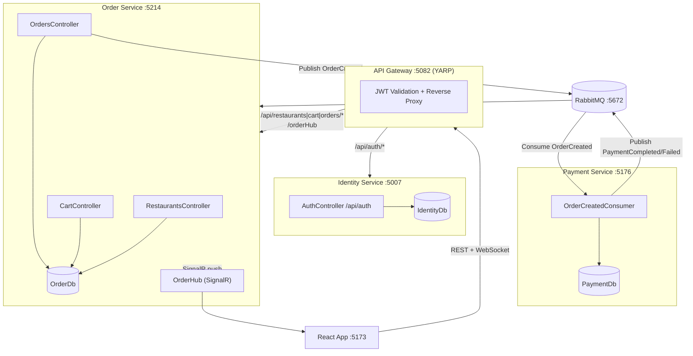

# 🍕 Food Delivery & Order Tracking Platform


A full-stack food delivery platform built with a **microservices architecture** on .NET 10 and React 19. Customers browse restaurants, manage a cart, place orders, and receive **real-time payment status updates** via SignalR — all without the browser ever talking directly to a backend service.

---

## Table of Contents

1. [Project Overview](#project-overview)
2. [Key Features](#key-features)
3. [Technology Stack](#technology-stack)
4. [Architecture](#architecture)
5. [Project Folder Structure](#project-folder-structure)
6. [What Makes This Project Unique](#what-makes-this-project-unique)
7. [Important Technical Implementations](#important-technical-implementations)
8. [Installation & Setup](#installation--setup)
9. [Screenshots](#screenshots)
10. [Future Enhancements](#future-enhancements)
11. [Author](#author)

---

## Project Overview

Three independently deployable ASP.NET Core services communicate through a **YARP API Gateway** (synchronous HTTP) and **RabbitMQ + MassTransit** (asynchronous events). The browser is always one hop away from the Gateway — it never calls a service directly.

Placing an order triggers a fully event-driven payment pipeline: the Order Service publishes `OrderCreated`, the Payment Service consumes it and publishes `PaymentCompleted` or `PaymentFailed`, the Order Service updates the order status, and a SignalR push notifies the customer's browser in real time — all without a single direct HTTP call between services.

---

## Key Features

| Feature | Detail |
|---|---|
| Microservices | Identity, Order, Payment — each with its own SQL Server database |
| API Gateway | YARP reverse proxy — single entry point, JWT validation, CORS |
| JWT Auth | Stateless, validated independently in each service (HMAC-SHA256, 2 h expiry) |
| Role-based access | `Customer` for cart/orders/hub · `Admin` for restaurant creation |
| Event-driven payments | RabbitMQ + MassTransit, no service-to-service HTTP calls |
| Idempotent payments | Unique index on `OrderId` — re-delivered events reuse the existing record |
| Real-time updates | SignalR groups — push goes only to the ordering customer |
| Cart enforcement | Single-restaurant per cart · max 99 units per item |
| Seeded data | Two restaurants and four menu items seeded on first migration |
| Protected routes | React `ProtectedRoute` with role check and redirect-back-after-login |
| Auto logout | Axios 401 interceptor fires a custom `auth:logout` DOM event |

---

## Technology Stack

| Layer | Technology |
|---|---|
| Frontend | React 19, Vite 8, React Router v7, Tailwind CSS v4, Axios, jwt-decode |
| Real-time | @microsoft/signalr v10, react-hot-toast |
| Backend | ASP.NET Core Web API, .NET 10 |
| API Gateway | YARP (Yet Another Reverse Proxy) |
| ORM | Entity Framework Core 10 (code-first, migrations, seeding) |
| Database | SQL Server — one database per service |
| Messaging | RabbitMQ, MassTransit |
| Auth | JWT Bearer (HMAC-SHA256) · ASP.NET Core `PasswordHasher<T>` |
| Shared contracts | `Shared.Events` C# class library (C# records) |

---

## Architecture



---

## Project Folder Structure

```
FoodDeliveryApplication/
├── ApiGateway/                     # YARP setup, JWT validation, CORS
├── IdentityService.Api/
│   ├── Controllers/AuthController.cs
│   ├── Models/                     # ApplicationUser, LoginDto, RegisterDto
│   ├── Repositories/               # IUserRepository, UserRepository
│   └── Services/                   # AuthService, TokenService
├── OrderService.Api/
│   ├── Controller/                 # CartController, OrdersController, RestaurantsController
│   ├── Contracts/                  # CartResponse, OrderResponse, request DTOs
│   ├── Data/OrderDbContext.cs      # EF config + seed data
│   ├── Hubs/OrderHub.cs            # SignalR hub (Customer role only)
│   ├── Messaging/PaymentResultConsumer.cs
│   ├── Models/                     # Order, OrderItem, Restaurant, MenuItem, CartEntry
│   ├── Repositories/               # IOrderRepository, IRestaurantRepository + impls
│   ├── Security/ClaimsPrincipalExtensions.cs
│   └── Services/                   # CartService, OrderServiceService, RestaurantService
├── PaymentService.Api/
│   ├── Data/PaymentDbContext.cs
│   ├── Messaging/OrderCreatedConsumer.cs
│   └── Models/PaymentRecord.cs
├── Shared.Events/
│   └── OrderEvents.cs              # OrderCreated, PaymentCompleted, PaymentFailed
└── food-delivery-frontend/
    └── src/
        ├── api/axios.js            # Axios instance + request/response interceptors
        ├── components/             # Button, Card, Input, Navbar, ProtectedRoute
        ├── context/                # AuthContext, AuthProvider
        ├── hooks/useOrderHub.jsx   # SignalR hook with auto-reconnect
        └── pages/                  # HomePage, RestaurantPage, CartPage, CheckoutPage,
                                    # OrderTrackingPage, CustomerOrdersPage, LoginPage, RegisterPage
```

---

## What Makes This Project Unique

**1. Fully decoupled payment pipeline**
The Payment Service has zero HTTP endpoints. It only consumes and produces RabbitMQ messages. Neither service knows the other's URL — they share only the `Shared.Events` contract library.

**2. Database-per-service with no cross-service reads**
Each service owns its schema. The Order Service snapshots item names and prices into `OrderItems` at checkout time so historical orders remain accurate even if menu prices change later.

**3. Idempotent event handling**
`PaymentDb.Payments` has a unique index on `OrderId`. If RabbitMQ re-delivers `OrderCreated`, the consumer detects the existing record and re-publishes the same result instead of creating a duplicate charge.

**4. Stateless JWT across services**
The Identity Service issues the token; the Order Service and API Gateway each validate it independently using the same shared key — no token introspection endpoint, no shared session store.

**5. SignalR scoped to the customer**
`OrderHub.JoinCustomerGroup()` adds the connection to a group keyed by the customer's GUID (extracted from the JWT `sub` claim). The `PaymentResultConsumer` pushes only to that group — other customers never receive the update.

**6. Atomic order placement**
`PlaceOrderAsync` wraps the order insert and cart clear in a single EF Core database transaction, so a crash between the two operations can never leave a customer with a placed order and a non-empty cart.

**7. Client-side token guard**
`getUserFromToken` in `auth.js` decodes the JWT client-side, checks expiry (`exp * 1000 <= Date.now()`), and handles both the short `role` claim and the full Microsoft claim URI — so the UI never shows a stale authenticated state.

**8. Automatic logout on 401**
The Axios response interceptor fires a custom `auth:logout` DOM event on any 401. `AuthProvider` listens for that event and clears state — any component tree can trigger a logout without prop drilling.

---

## Important Technical Implementations

### Order placement — atomic transaction + event publish

```csharp
// OrderServiceService.cs
await using var transaction = await _context.Database.BeginTransactionAsync();
await _repo.AddAsync(order);
_context.CartEntries.RemoveRange(cartEntries);
await _context.SaveChangesAsync();
await transaction.CommitAsync();

await _publishEndpoint.Publish(new OrderCreated(order.Id, order.CustomerId, order.TotalAmount));
```

### Idempotent payment consumer

```csharp
// OrderCreatedConsumer.cs
var payment = await _context.Payments.SingleOrDefaultAsync(p => p.OrderId == order.OrderId);
if (payment is null) { /* create and save */ }
// re-publish the existing outcome either way
```

### SignalR push scoped to one customer

```csharp
// PaymentResultConsumer.cs
await _hub.Clients.Group(order.CustomerId.ToString())
    .SendAsync("ReceiveOrderUpdate", order.Id.ToString(), order.Status);
```

### Client-side JWT expiry check

```js
// auth.js
if (!decoded.sub || !role || decoded.exp * 1000 <= Date.now()) return null;
```

### Axios auto-logout interceptor

```js
// axios.js
if (error.response?.status === 401) {
  localStorage.removeItem("token");
  window.dispatchEvent(new Event("auth:logout"));
}
```

### MassTransit retry policy (both services)

```csharp
rabbitMq.UseMessageRetry(retry =>
    retry.Intervals(TimeSpan.FromSeconds(1), TimeSpan.FromSeconds(3), TimeSpan.FromSeconds(5)));
```

---

## Installation & Setup

### Prerequisites

- [.NET 10 SDK](https://dotnet.microsoft.com/download)
- [Node.js 20+](https://nodejs.org/)
- SQL Server or SQL Server LocalDB
- RabbitMQ + Erlang/OTP
- EF Core CLI: `dotnet tool install --global dotnet-ef`

### 1. Clone

```powershell
git clone https://github.com/<your-username>/FoodDeliveryApplication.git
cd FoodDeliveryApplication
```

### 2. Apply migrations

```powershell
dotnet ef database update --project IdentityService.Api\IdentityService.Api.csproj
dotnet ef database update --project OrderService.Api\OrderService.Api.csproj
dotnet ef database update --project PaymentService.Api\PaymentService.Api.csproj
```

> The `OrderDb` migration seeds **Green Bowl Kitchen** and **Pizza Corner** with four menu items.

### 3. Frontend dependencies

```powershell
cd food-delivery-frontend && npm install && cd ..
```

### 4. Configuration

All defaults work out of the box for a local `localhost` SQL Server with Windows Auth and RabbitMQ with `guest/guest`. If your setup differs, update these files:

| File | Setting |
|---|---|
| `IdentityService.Api\appsettings.json` | `ConnectionStrings:DefaultConnection` |
| `OrderService.Api\appsettings.json` | `ConnectionStrings:DefaultConnection` |
| `PaymentService.Api\appsettings.json` | `ConnectionStrings:DefaultConnection` |
| `ApiGateway\appsettings.json` | `Jwt:Key / Issuer / Audience` |
| `OrderService.Api\Program.cs` | RabbitMQ host/credentials |
| `PaymentService.Api\Program.cs` | RabbitMQ host/credentials |
| `food-delivery-frontend\.env` | `VITE_API_BASE_URL`, `VITE_ORDER_HUB_URL` |

> The JWT key must be identical in `IdentityService.Api`, `OrderService.Api`, and `ApiGateway`. Minimum 32 characters.

### 5. Run

Open four terminals at the repository root:

```powershell
dotnet run --project IdentityService.Api\IdentityService.Api.csproj --launch-profile http
dotnet run --project OrderService.Api\OrderService.Api.csproj --launch-profile http
dotnet run --project PaymentService.Api\PaymentService.Api.csproj --launch-profile http
dotnet run --project ApiGateway\ApiGateway.csproj --launch-profile http
```

Start the frontend:

```powershell
cd food-delivery-frontend && npm run dev
```

Open **http://localhost:5173**

| Service | Port |
|---|---:|
| Identity Service | 5007 |
| Order Service | 5214 |
| Payment Service | 5176 |
| API Gateway | 5082 |
| React / Vite | 5173 |

### Build verification

```powershell
dotnet build FoodDeliverySolution.slnx
cd food-delivery-frontend && npm run lint && npm run build
```

---

## Screenshots

> Add screenshots to a `/screenshots` folder and update paths below.

| Page | Preview |
|---|---|
| Home / Restaurant List |  |
| Restaurant Menu |  |
| Cart |  |
| Order Tracking (live) |  |
| My Orders |  |

---

## Future Enhancements

- [ ] Docker Compose for one-command local startup
- [ ] Admin UI for managing restaurants and menu items
- [ ] Refresh token support
- [ ] Order cancellation before payment is processed
- [ ] Pagination on My Orders
- [ ] Integration tests with `WebApplicationFactory` + Testcontainers
- [ ] Structured logging with Serilog

---

## Author

**[Your Name]**

- GitHub: [@your-username](https://github.com/your-username)
- LinkedIn: [linkedin.com/in/your-profile](https://linkedin.com/in/your-profile)
- Email: your.email@example.com

---

> Built with .NET 10 · React 19 · RabbitMQ · SignalR · SQL Server
